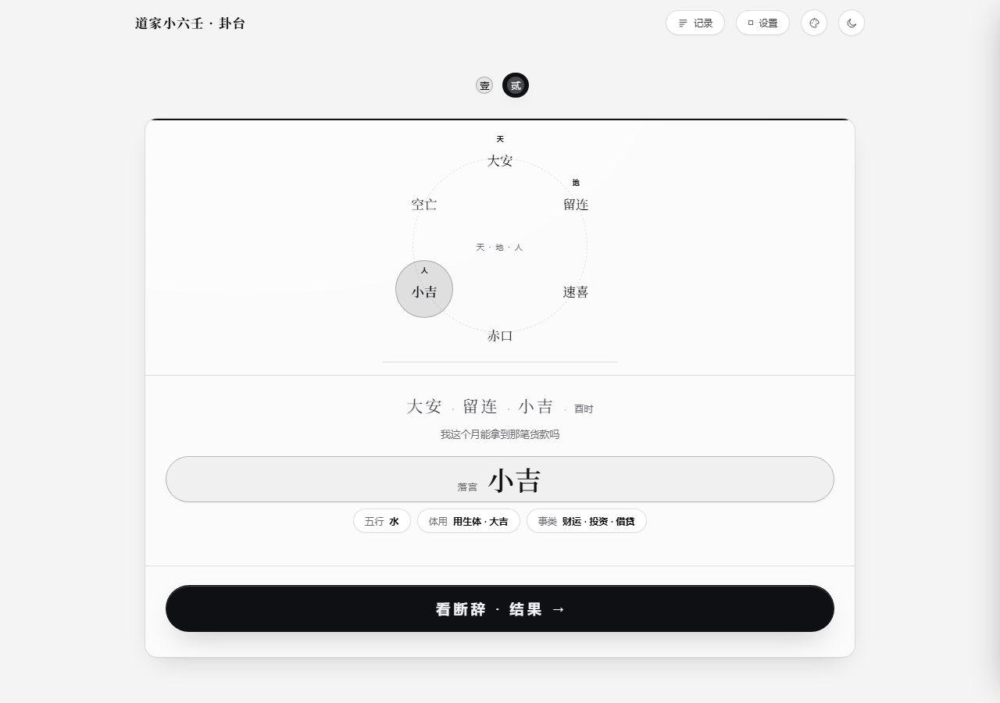
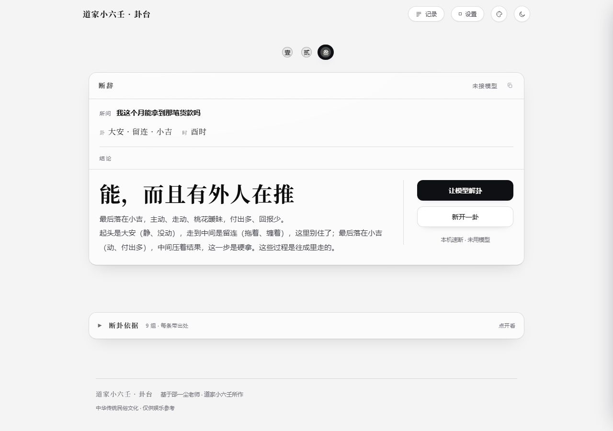
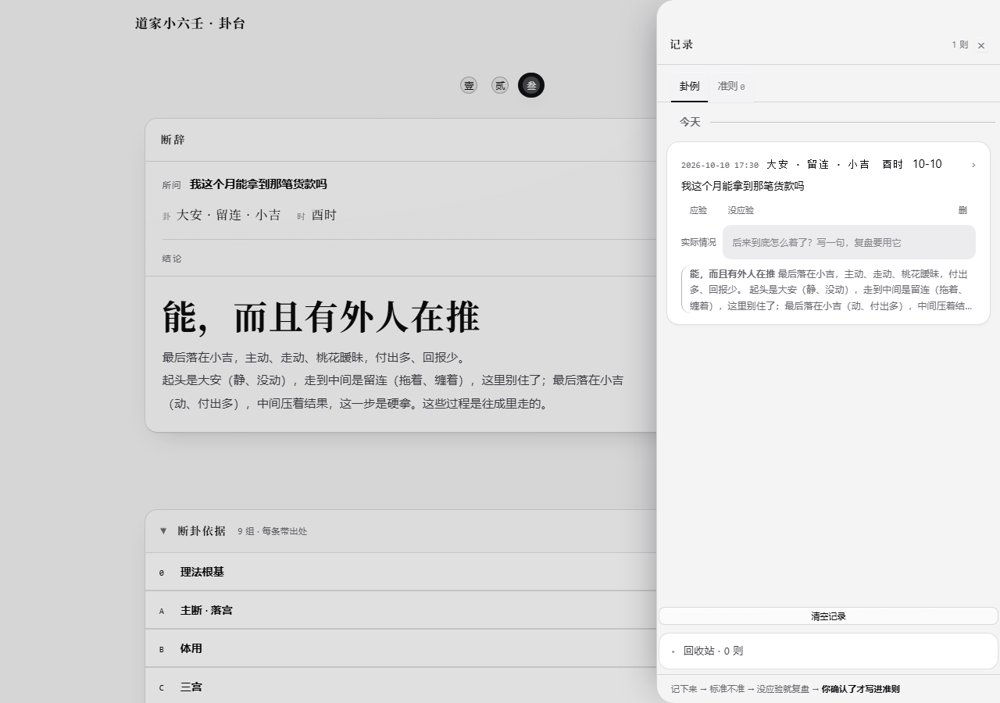
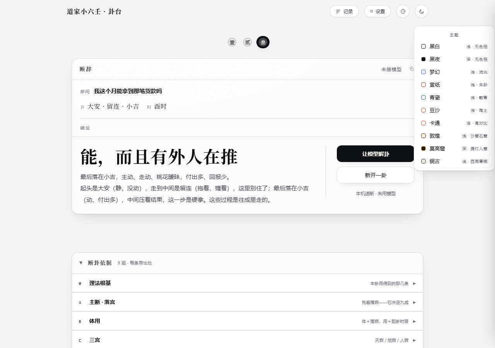
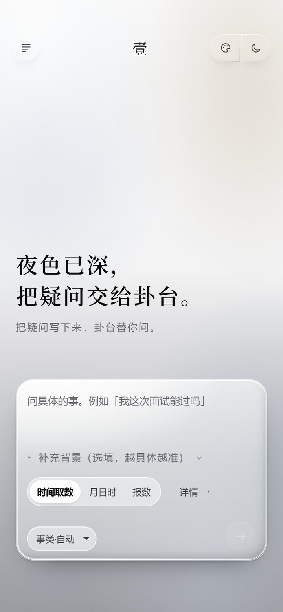
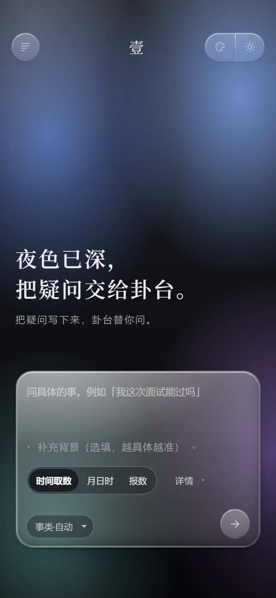

# 道家小六壬 · 卦台

一个在自己电脑和手机上用的小六壬工具：按下时间、或者报几个数，就把三宫排出来，给出六宫断辞、
体用、应期和事类速断。全部在本机算完，不联网、不上传、不需要注册。

要不要接大模型由你决定：不接就是纯本机速断；接了（任何 OpenAI / Anthropic 兼容的接口）可以让
模型照同一套判据把话说顺。**不接也完全能用。**

源码开源，判据是明文，随便改。

---

## 直接下载

不想自己编译的，去 [Releases](../../releases/latest) 拿现成的：

| 平台 | 文件 | 怎么装 |
|---|---|---|
| Windows | `guatai-…-windows.zip` | 解压到任意目录，双击 `道家小六壬·卦台.exe` |
| Android | `guatai-…-android.apk` | 传到手机点安装（会提示「未知来源」，允许即可） |

两个包都是**用本仓库的源码直接编译出来的**，没有别处塞进来的东西。介意的话可以自己编，见下面的「编译」。

> Windows 首次打开可能弹「Windows 已保护你的电脑」——点「更多信息 → 仍要运行」。
> 这是因为没买代码签名证书，任何个人开发的软件都这样。

## 能做什么

- **起卦**：时间取数、月日时三宫、报数、单宫取象、多选一；报 0 按 10 计。
- **排盘**：六神掌诀走位、天宫 / 地宫 / 人宫（落宫）定位、太极点转换。
- **断卦**：宫义、生克关系、三易、体用（体＝落宫，用＝起卦时辰）、应期取数。
- **事类速断**：婚姻、孕产、财运、工作、疾病、失物、行人、天气、官司、考试。
- **卦例本**：把起过的卦存下来，事后填应验，回头校准自己。
- **十套皮肤 + 明暗主题**，界面按桌面和手机两套布局分别写。
- **全程本机**：起卦、排盘、断辞都在本地算，模型那一环完全可选。

## 界面

**起卦 · 三宫排盘**



**断卦结果 · 六宫类象与应期**



**卦例本 · 记录与应验**



**皮肤**



**手机端（明 / 暗）**

| 明 | 暗 |
|---|---|
|  |  |

## 技术栈

| 端 | 技术栈 |
|---|---|
| 桌面（Windows / macOS） | React 19 · Vite 6 · Tauri 2 |
| 手机（Android） | React 19 · Vite 6 · Capacitor 6 |
| 判据 | 纯 JS 共享包，两端 `import` 同一份 |

## 编译

环境：Node 18+ · Rust（`cargo`）；Windows 还要 MSVC Build Tools。安卓另需 JDK 17 与 Android SDK。

```bash
npm install                     # 仓库根目录，一次就够

# 桌面端
cd apps/desktop-shell
npx --yes @tauri-apps/cli@^2 build
# → src-tauri/target/release/xiaoliuren.exe
```

```bash
# 安卓端
cd apps/mobile-web && npm run build
cd ../.. && node tools/stage-android-www.mjs
cd apps/mobile-shell && npx cap sync android
cd android && ./gradlew assembleDebug
# → app/build/outputs/apk/debug/app-debug.apk
```

编完是个单文件 exe（WebView2 加载器已经静态链进去），双击就能开。早期版本 Tauri 会额外生成一个
`WebView2Loader.dll`，如果你的构建产物旁边有它，一起带着就行。

没配签名也能编 —— 不填钥匙就走 Android 自带的调试签名，能装能玩。前端改完怎么重新打进产物、
每个目录干什么，写在 [BUILD.md](BUILD.md)。

## 判据在哪、怎么改

判据全在 `apps/shared-judgment/`，两端都引用它，改一处两端都生效。

```
corpus/00…08.md          九份体系文档（人读的真源，约 23 万字）
      ↓ node tools/gen-corpus.mjs
src/corpus.js            打包成代码读的形式
      ├─ src/prompt.js       解卦用的系统提示词
      ├─ src/judgment.js     六宫固定层 / 通用判据 / 应期 / 十类事类
      └─ src/asks.js         本机速断的按问法素材
```

想换一套判据、或者把某几条改成你自己的理解：直接改 `corpus/` 里的 Markdown，再跑一次
`node tools/gen-corpus.mjs` 就行，没有别的地方要同步。判据来源与口径见 [README-判据.md](README-判据.md)。

## 目录

| 目录 | 内容 |
|---|---|
| `apps/desktop-web/` | 桌面前端（React + Tailwind） |
| `apps/desktop-shell/` | Tauri 2 壳工程与加密后的前端壳 |
| `apps/mobile-web/` | 手机前端（与桌面端各自独立） |
| `apps/mobile-shell/` | Capacitor 6 壳 + 安卓工程 |
| `apps/shared-judgment/` | 判据与语料 |
| `apps/desktop-shell/pkg/` | Windows 启动器（检查 WebView2、缺了自动装） |
| `apps/*/build/` | 打包用的加密脚本 |
| `tools/` | 组装器、语料打包、安卓 stage |
| `mac/` | macOS / iOS 构建脚本 |
| `docs/images/` | 上面那些截图 |

## 说明

- 判据体系出自邵一尘先生的「道家小六壬」，应用内保留署名。
- 属中华传统民俗文化内容，仅供娱乐参考，不作决策依据。
- 仓库里不含签名物料、密钥与构建产物；`.gitignore` 已挡住。

## 许可

本仓按 [Apache License 2.0](LICENSE) 授权：可以自由使用、修改、分发、商用，
保留版权声明与许可副本即可；不提供任何担保。
